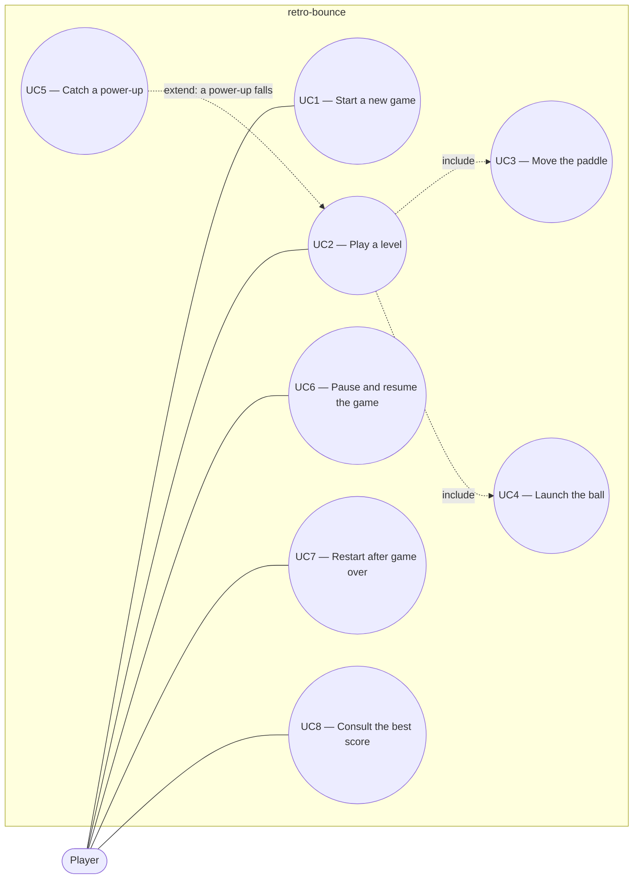

# Use case diagram — gameplay — V1 player goals

> **Feature**: core gameplay (V1 simple)
> **Related ADRs**: ADR-0001

## Context

Who wants what in retro-bounce V1. Single actor, solo game. Does NOT cover the technical structure (see `03-component.md`).

## Diagram

## Notes

- UC2 "Play a level" is the main goal: break all breakable bricks without losing the last life.
- "Catch a power-up" is an extension: only when a destroyed brick released one.
- Input devices (keyboard, mouse, touch) are not actors: all serve the same Player goals. Design is mobile-first: touch is the reference input, keyboard and mouse are equivalent alternatives.
- Textual spec UC2 — main scenario: 1. Player launches the ball. 2. Ball bounces and destroys bricks. 3. Player moves the paddle to return the ball. 4. All breakable bricks destroyed, level cleared. Extensions: 3a the last ball falls below the paddle, a life is lost, a new ball is placed on the paddle. 3b no life left, game over, Player may restart (UC7). 2a brick releases a power-up, Player may catch it (UC5).
