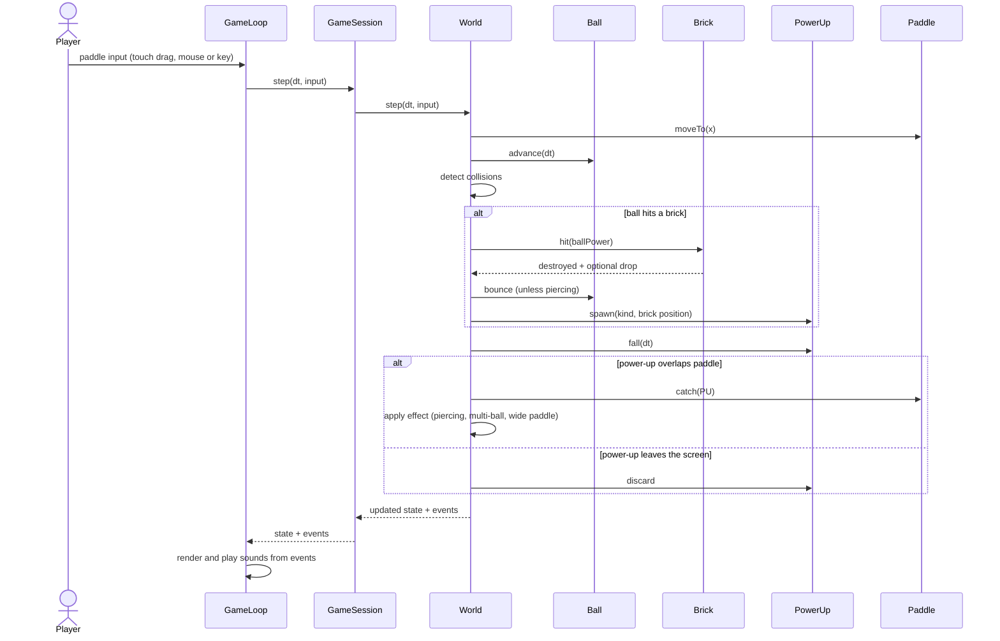

# Sequence diagram — gameplay — brick hit, drop and catch of a power-up

> **Feature**: core gameplay (V1 simple)
> **Related use cases**: UC2 Play a level, UC5 Catch a power-up

## Context

One fixed-step tick where the ball destroys a brick that releases a power-up, then the paddle catches it. Does NOT cover rendering details nor input handling.

## Diagram

## Notes

- The World returns events (brick destroyed, power-up caught, life lost) so rendering and audio stay outside the domain.
- Fixed time step, as in retro-shmup (its ADR-0002), makes the simulation reproducible and testable.
- Design choice for V1: a piercing ball skips the bounce and destroys every breakable brick it crosses (a strong brick included, which also keeps the simulation free of repeated hits while the ball overlaps a brick).
