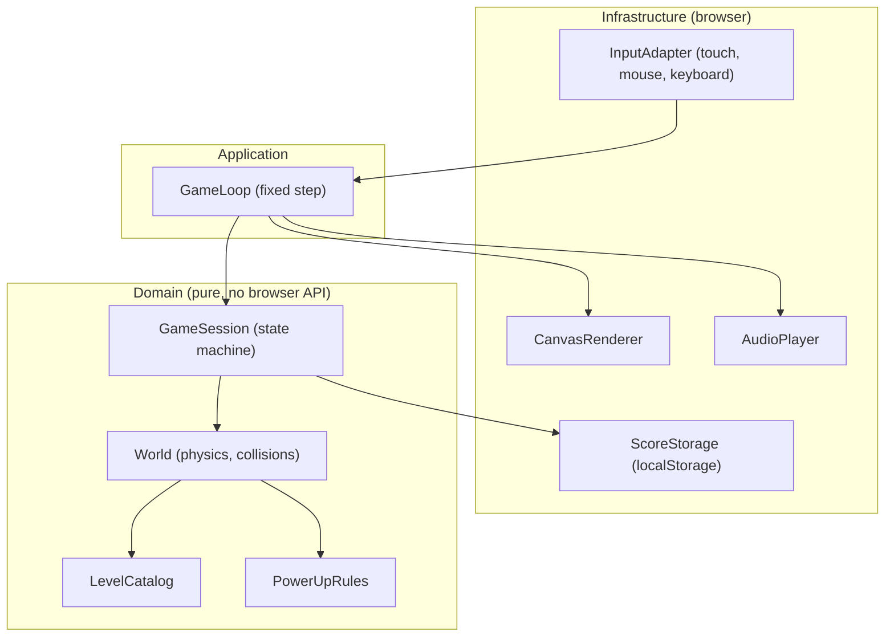

# Component diagram — gameplay — V1 structure

> **Feature**: core gameplay (V1 simple)
> **Related ADRs**: ADR-0001

## Context

Structural boundaries of the game. The dependency rule applies: the domain (World) imports nothing from infrastructure. Layering stays flat and proportional for a small game.

## Diagram

## Notes

- Mobile-first: CanvasRenderer scales a fixed logical resolution to any viewport and orientation, InputAdapter normalizes touch, mouse and keyboard into one paddle target.
- Task #6: the `GameSession` state machine is pure, so it sits in the domain (`src/domain/session.ts`); the application layer only drives it (fixed-step loop, input, storage).
- Task #7: `PowerUpRules` is realised by `powerup.ts` (drop, fall, catch) and `balls.ts` (ball pool, multi-ball split), both called by `world.ts`; no new component.
- Task #9: `GameLoop` is `app/frame-loop.ts` (+ `app/game-driver.ts` for tap-to-transition glue), `CanvasRenderer` is `adapters/canvas2d-renderer.ts` with `adapters/viewport.ts`; see sequence `07-sequence-frame-and-resize.md`.
- Domain is pure TypeScript, unit-testable without a browser.
- Boundaries to mock in tests: time, input, storage, audio.
- Layout mirrors retro-shmup, checked on 2026-10-16: `src/domain`, `src/adapters`, `src/app`, with adapters named like its `canvas2d-renderer`, `web-audio-player`, `local-storage-store`. Port interfaces are added only where a boundary needs mocking (see ADR-0001).
