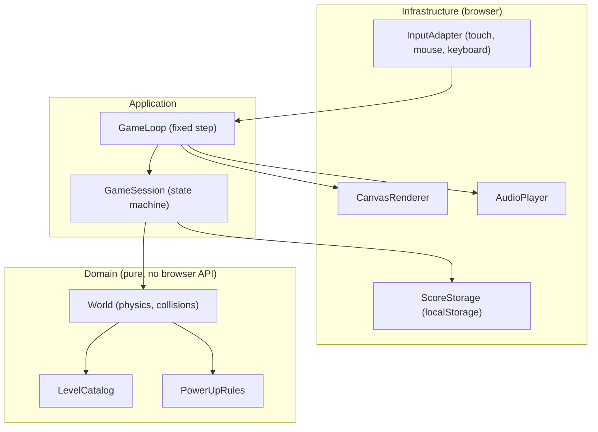

# Component diagram — gameplay — V1 structure

> **Feature**: core gameplay (V1 simple)
> **Related ADRs**: stack to be recorded (same as retro-shmup)

## Context

Structural boundaries of the game. The dependency rule applies: the domain (World) imports nothing from infrastructure. Layering stays flat and proportional for a small game.

## Diagram

## Notes

- Mobile-first: CanvasRenderer scales a fixed logical resolution to any viewport and orientation, InputAdapter normalizes touch, mouse and keyboard into one paddle target.
- Domain is pure TypeScript, unit-testable without a browser.
- Boundaries to mock in tests: time, input, storage, audio.
- Same layout philosophy as retro-shmup, to be confirmed when its tree is copied.
