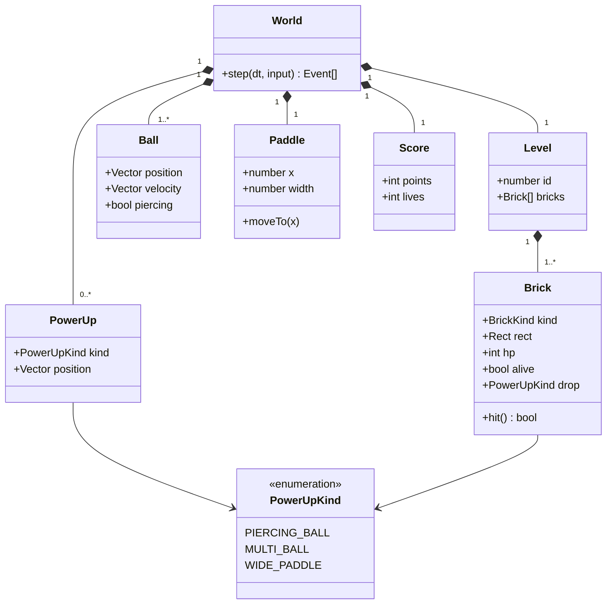

# Class diagram — gameplay — domain model V1

> **Feature**: core gameplay (V1 simple)

## Context

Domain entities of the World. Does NOT include rendering or input classes.

## Diagram

## Notes

- Multi-ball simply adds Ball instances. The level is lost only when the last ball falls.
- Piercing (8 s) and wide paddle (12 s) are timed effects, see the game design document.
- V1 scope: 3 power-ups, normal, strong (2 hits) and unbreakable bricks, values in the game design document.
- Code shape (task #6): `Score` and the lives are plain fields of the `Session` record (`score`, `lives`), which owns the `World` of the current level; `World` holds the ball, paddle and bricks of one level plus its seeded random generator.
- Code shape (task #5): `Ball` and `Paddle` are flat records (`x`, `y`, `vx`, `vy`) instead of `Vector` objects, to avoid allocation in the game loop. A brick keeps `kind`, `rect`, `hp` and `alive`; `breakable` is derived from `kind`. `hit()` returns true when the brick is destroyed.
- Code shape (task #7): `World` holds a fixed-capacity `BallPool` (6 balls, `balls.ts`) and a `PowerUpPool` (16 power-ups, `powerup.ts`) instead of lists, to avoid allocation in the game loop. The `piercing` flag is not stored on the ball: the world keeps timers (`piercingLeft`, `widePaddleLeft`) and passes `piercing` to `moveBall`. A power-up drop draws two numbers from the level's seeded generator (chance, then kind) per destroyed brick, in destruction order.
