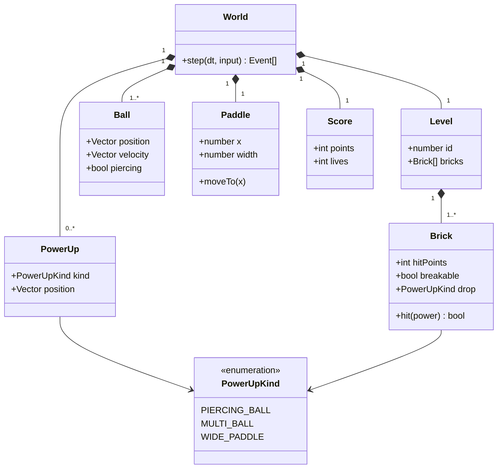

# Class diagram — gameplay — domain model V1

> **Feature**: core gameplay (V1 simple)

## Context

Domain entities of the World. Does NOT include rendering or input classes.

## Diagram

## Notes

- Multi-ball simply adds Ball instances. The level is lost only when the last ball falls.
- Piercing (8 s) and wide paddle (12 s) are timed effects, see the game design document.
- V1 scope: 3 power-ups, normal, strong (2 hits) and unbreakable bricks, values in the game design document.
