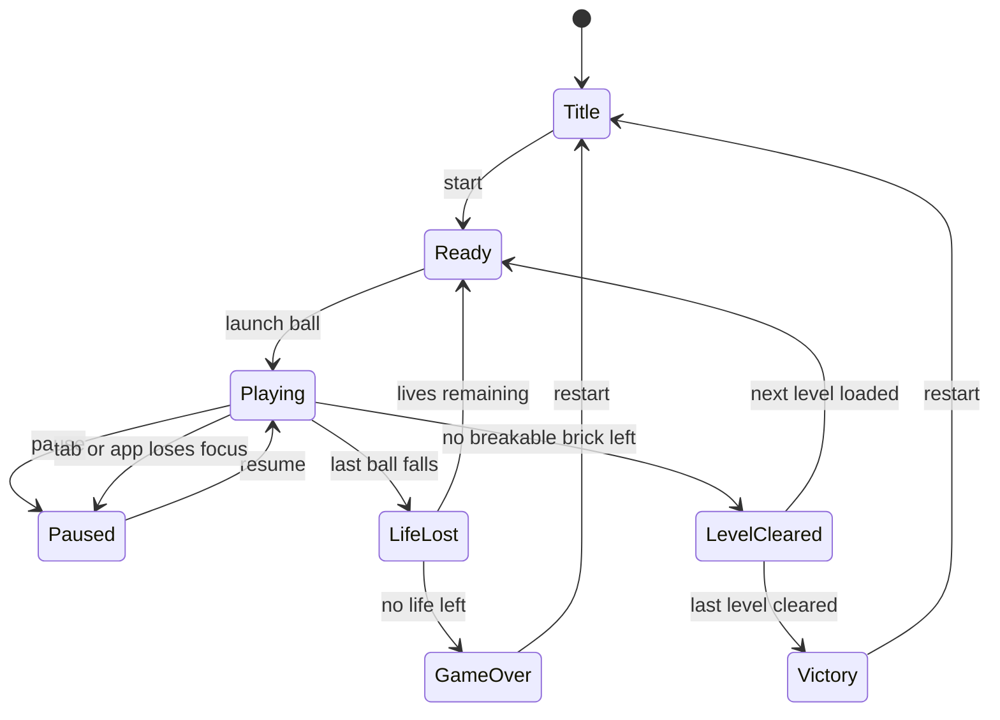

# State machine diagram — gameplay — game session

> **Feature**: core gameplay (V1 simple)

## Context

Lifecycle of one game session, from title screen to game over. Does NOT detail the ball or power-up states.

## Diagram

## Notes

- Auto-pause on focus loss matters on mobile (incoming call, app switch).
- Ready means the ball sits on the paddle, waiting for launch.
- Best score is saved on entering GameOver or Victory.
