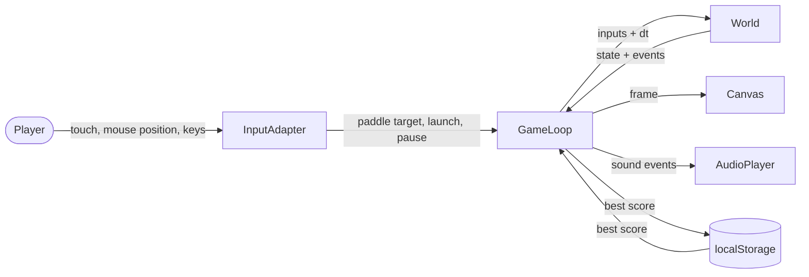

# Data-flow diagram — gameplay — V1 data

> **Feature**: core gameplay (V1 simple)

## Context

Which data moves where. No account, no network, no personal data.

## Diagram

## Notes

- PII: none. Only a numeric best score is persisted, locally.
- No network call in V1.
