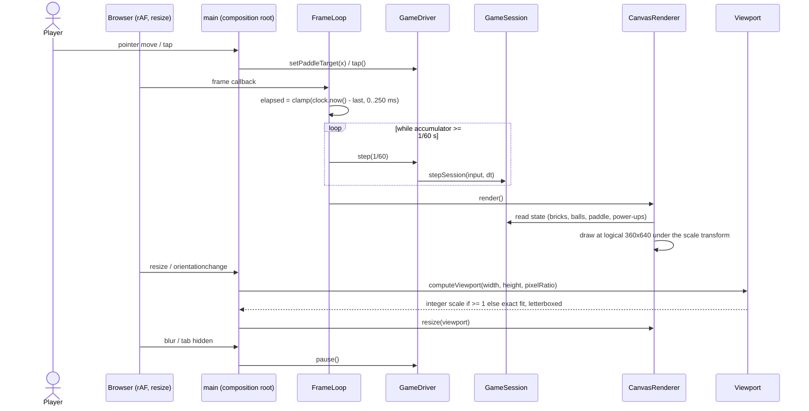

# Sequence diagram — gameplay — frame loop, rendering and viewport resize

> **Feature**: core gameplay (V1 simple), task #9
> **Related use cases**: UC2 Play a level

## Context

One browser frame: the fixed-step accumulator drains whole 1/60 s steps, then the canvas is drawn once. Also the window resize / rotation path. Does NOT cover input adapters beyond the minimal pointer glue.

## Diagram

## Notes

- Integer scale keeps pixels crisp; below x1 the exact fractional fit is used. The field stays portrait in any orientation, the rest is letterbox.
- The domain never sees the clock, the window or the canvas: `Clock` is a port, `main` is the only file touching globals.
